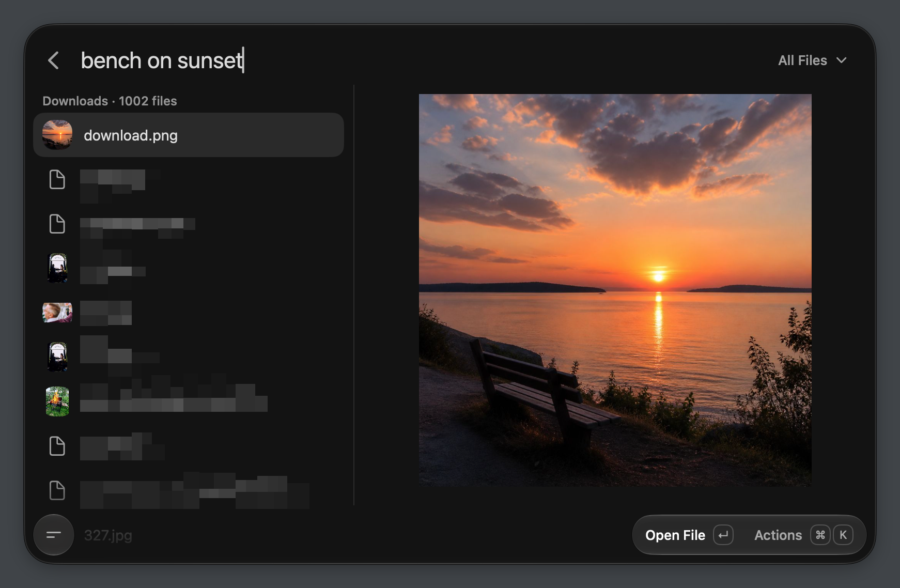
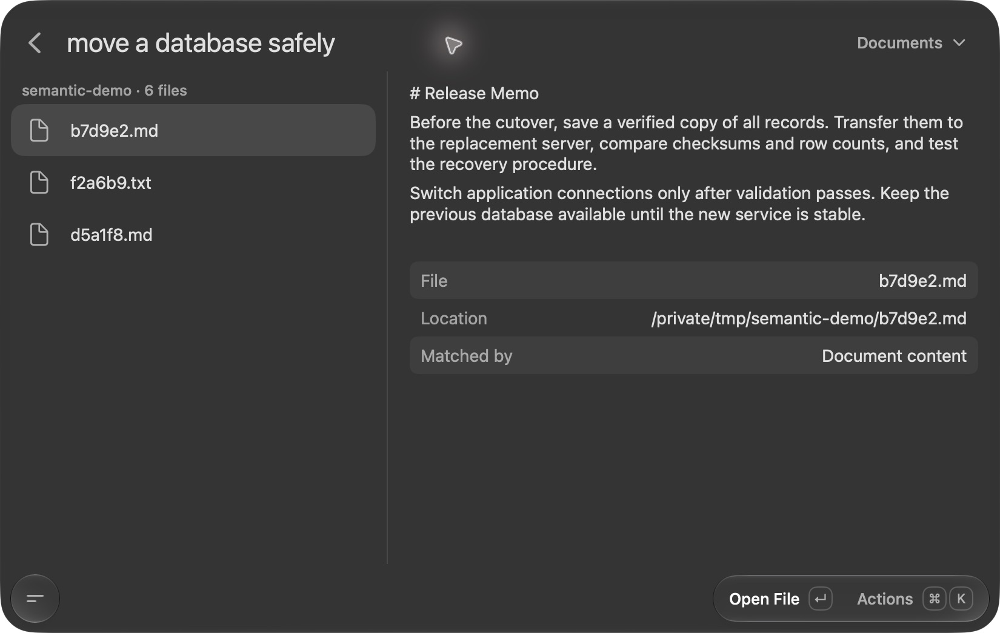
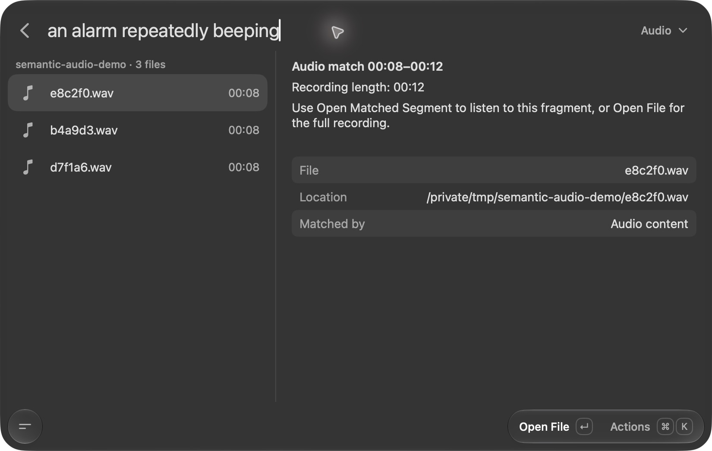

<h1 align="center">Semantic Search</h1>

Find files by what you remember. Local semantic search for Tinycast and Raycast.

Semantic Search finds documents, photos, video scenes and sounds by meaning. Describe what you need, preview a match, and open the original file.

## Preview

Find a photograph by describing what is in it.

Find a document by its contents, even when its filename gives no clues.

Find a recording by describing its sound, with a timestamp for the matching segment.

Examples shown in Tinycast. The document and audio examples use synthetic test files.

## How it works

1. Download **EmbeddingGemma 2** from the model settings. The model runs on your Mac.
2. Select folders. The engine reads supported files, converts their content into numerical vectors, and saves a local SQLite search index with paths and previews.
3. Search in natural language. The model converts your query into a vector and compares it with the saved index. Searching indexed photos, video or audio needs only the text encoder; media encoders load when indexing those files.

**Your files and queries stay on your Mac.** Semantic Search includes no analytics or telemetry and disables Hugging Face telemetry. Internet access is needed for requested model downloads and software installation/updates. Indexing, inference, previews and search run locally. This describes this project's behavior, not the launcher's own privacy policy.

## Install

Requires **Apple silicon and macOS 26+**. The [v0.5.0 release](https://github.com/nikusti/semantic-search/releases/tag/v0.5.0) includes Python and the required libraries: no Homebrew, pip or terminal setup.

1. Download and extract **semantic-search-v0.5.0.zip**.
2. Add the extracted **Semantic Search** folder in Tinycast's extension settings, or use **Import Extension** in Raycast.
3. Open **Semantic Search Model Settings**, choose folders and content types, then **Download & Apply**.
4. Open **Semantic Search** and describe a file. Files become searchable while indexing continues.

See [Installation](docs/INSTALL.md) for host-specific details. The [Raycast Store submission](https://github.com/raycast/extensions/pull/32190) is awaiting review; there is no Store listing yet. The extension and standalone engine share one codebase; [console use](docs/DEVELOPMENT.md#console-use-without-a-launcher) is also available.

## Models

Both built-in backends use conversions of Google's **EmbeddingGemma 2** with pinned revisions.

| Backend | Use |
| --- | --- |
| [MLX 8-bit](https://huggingface.co/mlx-community/embeddinggemma-2-8bit) · Recommended | Apple silicon inference through MLX. Approximately 1.27 GB of model files; text weights are quantized, vision/audio weights retain BF16. |
| [Core ML](https://huggingface.co/FluidInference/embeddinggemma-2-coreml) | Apple's runtime, with optional vision/audio encoders. Setup prepares text functions once; each search loads only the input length it needs. Text inputs are limited to 512 tokens. |
| Custom MLX URL | Compatible EmbeddingGemma 2 conversions only: BF16 or affine 4/8-bit, group size 64, native 768-dimensional output. Other LLMs, GGUF and original PyTorch weights are unsupported. |

**Each model/revision has its own index.** Equal vector sizes do not make different models interchangeable. Returning to the same model and indexing settings reuses saved vectors. Deleting model weights preserves indexes and your original files.

The default index uses **512-dimensional float32 vectors** (2,048 bytes each). “8-bit” describes model weights, not index storage. Other supported dimensions are 128, 256 and 768. Documents and photos are enabled by default; video and audio are optional. Model workers unload one minute after leaving search when no indexing or request is active. Core ML's startup optimization does not change MLX or existing vectors.

## Your library

- **Update Search Index** adds new/changed files, reuses unchanged vectors and removes deleted files. Updates are manual; no background schedule is enabled.
- Folder exclusions include subfolders. They can be saved during indexing and remove those records/previews from saved indexes without deleting files.
- Both launchers use **`~/Library/Application Support/Semantic Search/`** for models, indexes, settings and local logs. The local service listens only on loopback and rejects browser-origin requests; other local processes can access it.

Apple Photos/iCloud-only assets need an importer, which is not included. Scanned PDFs need a text layer; OCR is not included. Audio search matches sounds, not transcripts. Video sampling can miss brief events. See [supported files, limits and advanced options](docs/USAGE.md).

## Project

[Version history](CHANGELOG.md) · [Troubleshooting](docs/TROUBLESHOOTING.md) · [Development](docs/DEVELOPMENT.md) · [Store packaging](docs/STORE.md) · [Roadmap](docs/ROADMAP.md)

Application source is [MIT-licensed](LICENSE). Bundled libraries and model weights retain their upstream licenses. Each binary release includes dependency notices and corresponding [native sources/build recipes](packaging/codec-notices/README.md). No model weights, personal files, configuration or existing indexes are included in releases.
